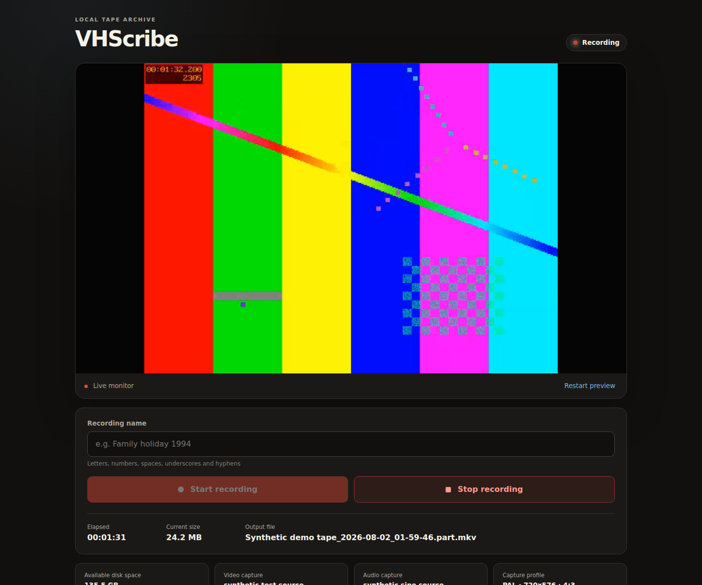
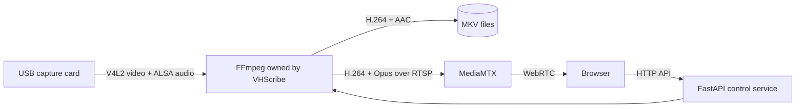

# VHScribe

Browser-controlled, local-first VHS capture for a headless Linux server.

[](https://github.com/paulcakeface/vhscribe/actions/workflows/ci.yml)
[](https://github.com/paulcakeface/vhscribe/actions/workflows/container.yml)
[](LICENSE)



VHScribe gives a USB capture card a simple web interface: preview the signal, name a tape,
record an H.264/AAC Matroska master, and recover interrupted captures. It is designed for a
trusted home network and keeps media on storage you control.

## Key features

- Low-latency browser preview through MediaMTX and WebRTC
- One supervised FFmpeg process, so preview and recording never fight over a capture device
- PAL (720×576 at 25 fps) and NTSC (720×480 at 30000/1001 fps) capture profiles
- Explicit 4:3 display-aspect signaling without resizing the encoded master
- Crash-tolerant `.part.mkv` recording and manual, non-destructive recovery
- Read-only device suggestions for V4L2 video and ALSA audio
- Local Docker Compose deployment with loopback-only defaults
- Synthetic capture mode for development and CI—no VHS hardware required

## Architecture



In plain terms: the FastAPI service owns one FFmpeg process. FFmpeg writes the master file and
publishes a lightweight preview to MediaMTX; the browser controls the service over HTTP and views
the preview over WebRTC. See [the detailed architecture](docs/architecture.md).

## Supported and tested hardware

Confirmed on the current reference system:

- Ubuntu Server 24.04 on `linux/amd64`
- MacroSilicon MS210x USB capture hardware using the Linux `uvcvideo` driver
- PAL composite video at 720×576 and ALSA stereo audio
- Docker Engine 29 with Docker Compose v2

Likely compatible, but not yet confirmed by the maintainers:

- EasyCAP-style devices that expose standard V4L2 video and ALSA capture endpoints
- Other Debian/Ubuntu releases with a current Docker Engine
- `linux/arm64` hosts with supported USB capture devices; CI validates the container build, not
  physical ARM capture hardware
- NTSC hardware input; the NTSC FFmpeg path is covered with synthetic tests

Please report working combinations through the hardware compatibility issue template. No device
is considered supported solely because it uses the EasyCAP name.

## Requirements

- A Linux host with Docker Engine and the Docker Compose plugin
- A capture adapter visible as V4L2 video and ALSA audio
- Membership in the host `video`, `audio`, and Docker-access groups as appropriate
- Local storage with enough free capacity for the chosen bitrate
- A modern browser on the same trusted host or LAN

On Ubuntu, install the discovery tools and grant device access:

```bash
sudo apt update
sudo apt install -y v4l-utils alsa-utils git
sudo usermod -aG video,audio "$USER"
# Add yourself to the docker group only if that matches your Docker security model:
sudo usermod -aG docker "$USER"
```

Log out and back in after changing group membership. Docker group membership is effectively
root-level access; using `sudo docker ...` instead is a valid alternative.

## Quick start

```bash
git clone https://github.com/paulcakeface/vhscribe.git
cd vhscribe
./scripts/discover-hardware.sh
cp .env.example .env
chmod 600 .env
mkdir -p captures
```

Edit `.env` with the discovered device names. Keep `SERVER_ADDRESS=127.0.0.1` for host-only
access, or set it to one specific private LAN address for trusted-LAN access. Then start and verify:

```bash
docker compose up -d --build
./scripts/verify-installation.sh
docker compose ps
```

Open `http://127.0.0.1:8090` from the server. If you selected a LAN address, use that address
instead. The service intentionally has no built-in user authentication; do not expose it to the
public internet.

## Configuration

Compose reads the untracked `.env` file in the project directory.

| Variable | Example/default | Purpose |
| --- | --- | --- |
| `SERVER_ADDRESS` | `127.0.0.1` | Exact host address for HTTP and WebRTC binds |
| `HTTP_PORT` | `8090` | Dashboard/API TCP port |
| `WEBRTC_HTTP_PORT` | `8889` | MediaMTX WebRTC player/signaling TCP port |
| `WEBRTC_UDP_PORT` | `8189` | WebRTC media UDP port |
| `CAPTURE_DIRECTORY` | `./captures` | Host directory mounted at `/captures` |
| `VIDEO_DEVICE` | `/dev/video0` | Host V4L2 capture endpoint |
| `AUDIO_DEVICE` | `hw:CARD=Device,DEV=0` | ALSA capture identifier |
| `VIDEO_STANDARD` | `PAL` | `PAL` or `NTSC`; selects master size, rate, and sample aspect |
| `PUID` / `PGID` | `1000` / `1000` | Host user/group IDs used for capture-file ownership |
| `VIDEO_GROUP_ID` | `44` | Numeric host group allowed to open V4L2 devices |
| `AUDIO_GROUP_ID` | `29` | Numeric host group allowed to open ALSA devices |
| `PREVIEW_RESOLUTION` | `640x480` | Browser-preview encode size |
| `PREVIEW_VIDEO_BITRATE` | `800k` | Preview H.264 target bitrate |
| `PREVIEW_AUDIO_BITRATE` | `64k` | Preview Opus bitrate |
| `RECORDING_VIDEO_BITRATE` | `2000k` | Master H.264 target bitrate |
| `RECORDING_VIDEO_MAXRATE` | `2400k` | Master H.264 rate ceiling |
| `RECORDING_VIDEO_BUFFER` | `4000k` | Master encoder VBV buffer |
| `RECORDING_AUDIO_BITRATE` | `128k` | Master AAC bitrate |
| `AUDIO_RATE` | `48000` | Master audio sample rate |
| `AUDIO_CHANNELS` | `2` | Audio channel count |
| `TZ` | `Etc/UTC` | Container timezone and filename timestamp basis |
| `LOG_LEVEL` | `INFO` | Application log level |
| `FFMPEG_LOG_LEVEL` | `warning` | FFmpeg diagnostic verbosity |
| `APP_IMAGE` | unset | Optional prebuilt image, such as a GHCR tag |

Changing `VIDEO_STANDARD` never resizes an existing recording. The profile only affects future
captures.

## Recording workflow

1. Rewind and connect the tape deck, then verify video and audio in the live preview.
2. Enter a short recording name and select **Start recording**.
3. VHScribe switches its single FFmpeg process from preview-only mode to recording-plus-preview.
4. Select **Stop recording**. FFmpeg closes the MKV, `ffprobe` confirms video and audio streams,
   and the `.part.mkv` is atomically renamed to `.mkv`.
5. Play or download the completed file from the recent-recordings list.

Use the dashboard stop button before stopping Compose during an active capture. For a normal
shutdown:

```bash
docker compose stop -t 45
```

## PAL and NTSC notes

PAL records at 720×576/25 fps with sample aspect ratio 16:15. NTSC records at
720×480/30000:1001 fps with sample aspect ratio 8:9. Both signal a 4:3 display aspect ratio while
retaining their native standard-definition encoded dimensions. VHScribe does not deinterlace or
upscale the master; preservation processing can be performed later on a copy.

## Recovering interrupted recordings

If the host or process stops unexpectedly, VHScribe leaves the `.part.mkv` untouched. After the
service restarts, interrupted items appear in the dashboard with a **Recover** action. Recovery
stream-copies the existing tracks into a new MKV, validates it, and preserves the original partial
file. Automatic deletion is deliberately avoided.

## Security and network access

- The example configuration binds all published ports to `127.0.0.1`.
- The application has no authentication or TLS. Limit LAN access with host firewall rules and do
  not port-forward it.
- The containers are not privileged, drop Linux capabilities, use read-only root filesystems, and
  map only the configured video endpoint plus `/dev/snd`.
- `.env`, media, logs, runtime state, test output, and unreviewed screenshots are ignored by Git and
  excluded from the image build context.
- Recording names are sanitized, file access rejects path traversal, and FFmpeg is invoked with
  argument arrays rather than a shell.

See [SECURITY.md](SECURITY.md) before deploying outside a single trusted machine.

## Operations

Upgrade while preserving configuration and recordings:

```bash
git pull --ff-only
docker compose build --pull
docker compose up -d
./scripts/verify-installation.sh
```

Back up `.env` separately and back up the configured capture directory using your normal storage
tooling. Logs and runtime state are disposable; recordings are not.

Uninstall the containers without deleting recordings:

```bash
docker compose down --remove-orphans
```

Do not add `--volumes`, and do not remove `CAPTURE_DIRECTORY`, unless you independently intend to
delete those files.

## Troubleshooting

- **No devices:** run `./scripts/discover-hardware.sh`, reconnect the adapter, and confirm group
  membership after logging in again.
- **Preview works only on the server:** bind `SERVER_ADDRESS` to one specific private LAN address
  and allow the configured TCP/UDP ports through the host firewall.
- **Black, unstable, or incorrectly timed video:** confirm `VIDEO_STANDARD` matches the tape/player
  output and that the selected V4L2 endpoint advertises the required mode.
- **No audio:** test the exact ALSA source with `arecord`; numeric card indexes can move after a
  reboot, so a stable card name is preferable.
- **A partial file remains:** use the dashboard recovery action. Do not rename a file that is still
  active.

The full decision tree is in [docs/troubleshooting.md](docs/troubleshooting.md).

## Development and testing

```bash
python3 -m venv .venv
. .venv/bin/activate
pip install -r requirements-dev.txt
ruff format --check .
ruff check .
pytest -q
docker compose -f compose.yaml -f compose.synthetic.yaml up -d --build
```

Synthetic mode replaces physical V4L2/ALSA inputs with FFmpeg test video and a sine wave. See
[docs/development.md](docs/development.md) for the end-to-end test and contribution workflow.

## Contributing

Bug reports, hardware compatibility results, documentation corrections, and focused pull requests
are welcome. Start with [CONTRIBUTING.md](CONTRIBUTING.md) and follow the
[Code of Conduct](CODE_OF_CONDUCT.md).

## Roadmap

- Guided device/profile selection with explicit confirmation
- More capture-card compatibility reports and ARM hardware validation
- Optional authentication for broader private networks
- Better long-running capture metrics and alerts
- Optional tape-end detection that never risks truncating a recording
- Exportable capture metadata and preservation checksums

## License

VHScribe uses the [MIT License](LICENSE). MIT is short, widely understood, and permits personal,
commercial, and derivative use while retaining the copyright and warranty notice—an appropriate
fit for encouraging hardware experimentation and contributions.

## Acknowledgements

VHScribe builds on [FFmpeg](https://ffmpeg.org/),
[MediaMTX](https://github.com/bluenviron/mediamtx), [FastAPI](https://fastapi.tiangolo.com/), and the
Linux V4L2/ALSA ecosystem. The application was developed with extensive assistance from OpenAI
Codex; OpenAI does not sponsor or endorse the project.
