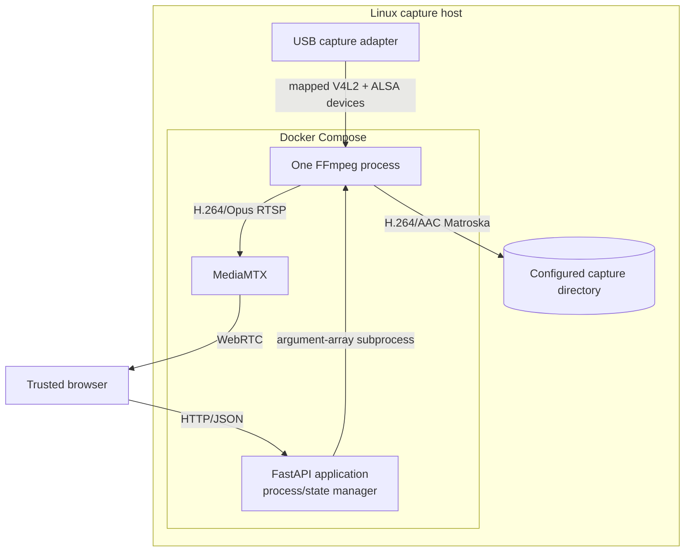

# Architecture

VHScribe keeps capture ownership deliberately narrow: the FastAPI application supervises exactly
one FFmpeg process. MediaMTX is a transport component and never opens the hardware itself.

Without Mermaid: the browser calls FastAPI; FastAPI owns at most one FFmpeg process. FFmpeg is
absent while idle. Preview-only mode reads the USB adapter and sends a low-bitrate stream to
MediaMTX. Recording mode reads the adapter once, writes the MKV, and sends a preview branch to
MediaMTX; MediaMTX sends WebRTC to the browser.

## Process state

```mermaid
stateDiagram-v2
    [*] --> Idle
    Idle --> StartingPreview: start preview
    StartingPreview --> PreviewAvailable: preview publisher ready
    PreviewAvailable --> Stopping: manual stop or heartbeat timeout
    Stopping --> Idle: devices released
    Idle --> StartingRecording: start recording
    PreviewAvailable --> StartingRecording: start accepted
    StartingRecording --> Recording: FFmpeg stable
    Recording --> Stopping: stop accepted
    Stopping --> Idle: validated and renamed
    StartingPreview --> Error: process/device failure
    Recording --> Error: unexpected exit; partial retained
    Error --> StartingPreview: explicit retry
    Error --> StartingRecording: explicit recording start
```

State changes are serialized by one manager lock. Starting a recording first stops the preview
process and then starts one combined recording/preview process. This prevents two readers opening
the same V4L2 or ALSA endpoint. A visible browser sends preview heartbeats; when none arrive for the
configured timeout, preview-only FFmpeg stops gracefully. Heartbeats never govern recording mode.

## File lifecycle

1. A sanitized recording name and timestamp create a unique `*.part.mkv` path.
2. FFmpeg writes Matroska clusters frequently so an interrupted file has a better chance of being
   recoverable.
3. A normal stop sends `SIGINT`, waits for FFmpeg to close the container, and then runs `ffprobe`.
4. Only a non-empty file containing video and audio is atomically renamed to `*.mkv`.
5. A failed validation leaves the partial file unchanged.
6. Manual recovery stream-copies a partial into a separate MKV and preserves the source.

## Video paths

The recording filter splits the decoded input once. The master branch applies only sample-aspect
metadata: PAL uses 16:15 and NTSC uses 8:9, both yielding 4:3 display. The preview branch scales to
the configured preview resolution. The master never inherits that preview scaling.

## Trust boundaries

- The capture directory and devices are explicit host mounts.
- The application container has a read-only root filesystem; only capture, log, state, and temporary
  mounts are writable.
- MediaMTX accepts an RTSP publisher only on the internal Compose network; public host mappings are
  limited to its WebRTC player/signaling and media ports.
- There is no end-user authentication in 0.1.x. Host binds and firewall policy are the access
  control boundary.

## Design invariants

- Never use `privileged: true`.
- Never build FFmpeg commands through a shell.
- Never run two hardware capture processes.
- Never delete or silently replace partial recordings.
- Never call a file complete before media validation.
